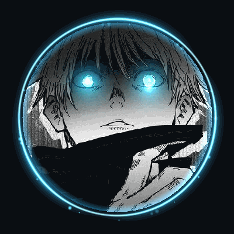

  
    
  
    
  
    

---

# About Me

> I'm a curious learner who loves to understand how things work and turn ideas into reality. 
 I believe the best way to learn is by getting my hands dirty, experimenting, making mistakes, 
 and figuring things out.

 **I don't learn just to get a job. I learn because I love to build, 
 solve real-world problems, and turn my knowledge into something useful.**

 **I strongly believe in building projects, not just watching tutorials - because 
 the real learning begins when you start building.**

> For me, every project is more than just a project; it's a chance to learn, experiment, 
and create something that has a purpose.

---

# Tech Stack & Tools

<table>
<tr>
<td valign="top" width="16%">

### Languages

 

 

</td>

<td valign="top" width="16%">

### Frontend

 

 

 
</td>

<td valign="top" width="16%">

### Backend

 

</td>

<td valign="top" width="16%">

### Database

</td>

<td valign="top" width="18%">

### AI / ML & Data

 

 

 

</td>

<td valign="top" width="18%">

### Tools & Deployment

 

 

 

 

</td>
</tr>
</table>

---

#  Projects

| Project | Description | Tech Stack |
|---|---|---|
| [**RescueBite AI**](https://github.com/ashish-dev-hub/RescueBite-AI) | AI-powered surplus-food redistribution platform that connects donors like restaurants and grocery stores with NGOs, with coordinator-approved allocations, delivery tracking and demand forecasting. | React, Vite, Node.js, Express.js, MongoDB, Python, FastAPI, ML |
| [**InternMatch-AI**](https://github.com/ashish-dev-hub/InternMatch) | AI-powered job and internship matching platform that evaluates candidate-job fit, predicts salary and recommends roles for students and recruiters. | React, Vite, Tailwind CSS, Node.js, Express.js, MongoDB, Python, FastAPI, XGBoost, Scikit-learn |
| [**Career Sense**](https://github.com/ashish-dev-hub/CareerSense) | AI-powered career intelligence platform that connects skill-gap analysis, personalized roadmaps, project ideas, resume feedback and interview practice into one career-readiness workflow for students. | React, Tailwind CSS, JavaScript, Node.js, Express.js, MongoDB Atlas, Google Gemini API |
| [**Student Exam Score Predictor**](https://github.com/ashish-dev-hub/student-predictor) | ML application for predicting student exam performance using academic and lifestyle-related features. | Python, Pandas, NumPy, Scikit-learn, Streamlit |

---

## GitHub Stats

  <picture>
    <source
      media="(prefers-color-scheme: dark)"
      srcset="https://raw.githubusercontent.com/ashish-dev-hub/ashish-dev-hub/output/github-snake-dark.svg"
    />
    <source
      media="(prefers-color-scheme: light)"
      srcset="https://raw.githubusercontent.com/ashish-dev-hub/ashish-dev-hub/output/github-snake.svg"
    />
    
  </picture>

## Profile Views

<i>Still learning, still building - every project ships something new</i>

---